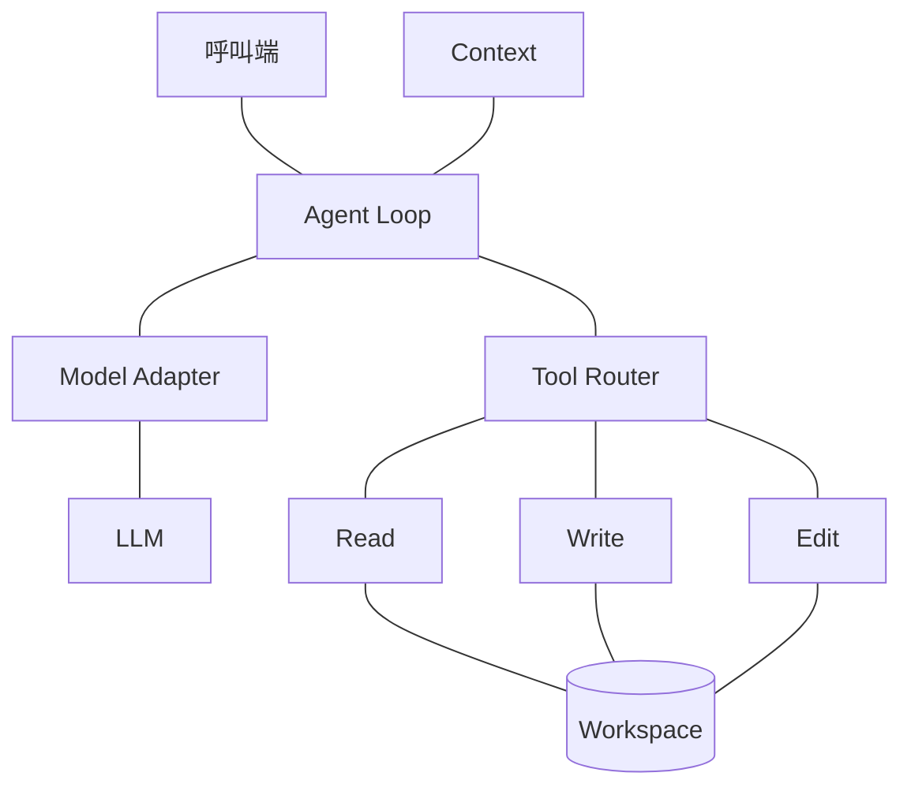
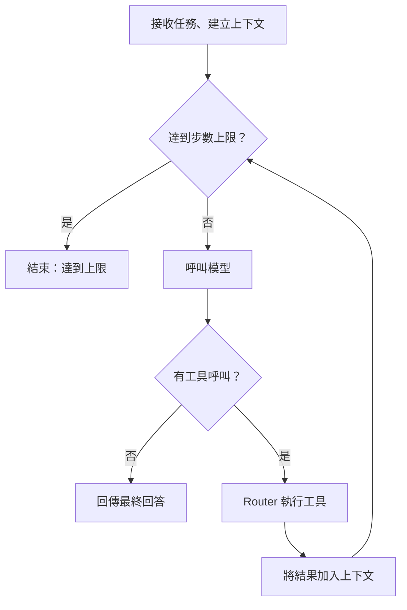

# mini-agent-harness

最小的 Agent Harness：接收任務，控制模型與檔案工具反覆互動，最後回傳模型的回答。

第一版提供 Python API；session、CLI、TUI 與 bash 留待後續。

## 元件關係



連線表示元件之間有互動；執行順序見下方流程圖。

**Agent Loop 是協調中心。** 它使用 Context 保存訊息，透過 Model Adapter 呼叫 LLM，並將模型提出的工具呼叫交給 Router。Router 派送至 Read、Write、Edit，結果回到 Loop，加入下一輪上下文。

Tool Definitions 提供模型與 Router 共用的工具規格。

## 元件責任與 I/O

| 元件 | 負責什麼 | Input | Output |
| --- | --- | --- | --- |
| Agent Loop | 管理模型與工具互動、決定是否繼續 | 任務、workspace、model、設定 | RunResult |
| Model Adapter | 對接模型服務，轉換請求與回應格式 | messages、tool definitions | 文字、tool calls |
| Tool Definitions | 描述工具可做什麼、需要哪些參數 | 開發者定義的規格 | 提供模型與 Router 使用的 schema |
| Tool Router | 驗證參數、依工具名稱派送 | name、arguments、workspace | ToolResult |
| Context | 保存本次任務的訊息 | 任務、模型回應、工具結果 | 下一輪使用的完整 messages |

### 檔案工具

| 工具 | Input | 成功 Output | 行為 |
| --- | --- | --- | --- |
| `read_file` | `path` | `{ok: true, content}` | 讀取完整檔案 |
| `write_file` | `path, content` | `{ok: true, bytes_written}` | 建立或覆寫檔案 |
| `edit_file` | `path, start_line, end_line, replacement` | `{ok: true, bytes_written}` | 替換指定行範圍 |

檔案使用 UTF-8，路徑相對於 workspace，解析後必須仍在 workspace 內。write 要求父目錄已存在。edit 行號從 1 起算，起訖皆包含，replacement 原樣插入；非法行範圍回傳錯誤。`bytes_written` 是寫入整份檔案的 UTF-8 byte 數。

## 一次任務如何執行



每輪先保存完整模型回應，再循序執行工具。每個工具結果都帶上對應的 `tool_call_id`，讓模型知道它屬於哪次呼叫。

可預期的工具錯誤同樣回傳給模型，讓它修正。模型服務失敗或非預期內部錯誤則結束執行，回傳 `status=error`；第一版不自動重試。

**Context 保存的是下一輪要送給模型的上下文。** 第一版不載入歷史紀錄，也不做摘要或壓縮。

## 對外介面（設計中）

```python
run(task, workspace, model, max_steps=10) -> RunResult
```

`RunResult` 包含 `status`、`answer`、`steps`、`error`；status 為 `completed`、`max_steps` 或 `error`。目前專案仍是 Python 骨架，以上 API 尚未實作。

詳細的資料契約、錯誤處理、檔案分工與實作順序，見 [完整藍圖](docs/blueprint.md)。
