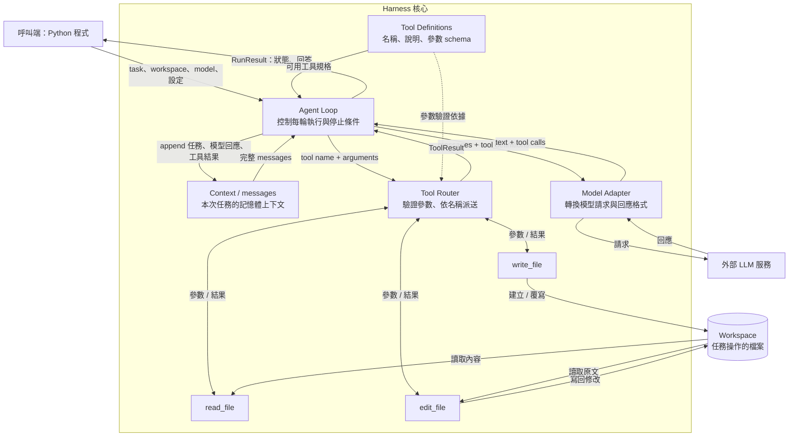

# mini-agent-harness：最小藍圖草案

目標：給定一個任務和工作目錄，控制模型反覆呼叫檔案工具，直到模型產生最終回答。

本階段只設計核心 Python API，不實作 session、CLI、TUI 或 bash。未來的 `my-agent --dir <workspace> "<task>"` 只是這個 API 的入口。

## 0. 元件關係：誰控制誰、資料放哪裡

這張圖描述元件關係；下一節之後的執行路徑則描述一次任務的時間順序。



**Agent Loop 是協調中心。** 它持有本次 run 的 messages，呼叫模型、接收 tool calls、交給 Router，再把結果加回 messages。是否繼續下一輪由 Loop 根據模型回應與步數上限決定。

**LLM 提出工具呼叫，Router 負責執行派送。** LLM 不直接存取本機檔案；真正碰到 workspace 的是 read/write/edit。三個工具共用 tools.py 裡的路徑驗證，Router 和工具都不自行呼叫模型。

**Context 是下一輪要傳給模型的訊息資料，不需要再呼叫一個服務。**

Tool Definitions 是模型與 Router 共用的規格資料，不是另一個會做決策的服務。圖中的元件是責任分工，不代表每個框都需要獨立的 class、process 或檔案。

## 1. 對外介面

```python
run(task, workspace, model, max_steps=10) -> RunResult
```

- `task: str`：使用者任務。
- `workspace: Path`：所有檔案工具允許操作的根目錄。
- `model`：注入的模型 adapter，不在 loop 裡綁定特定供應商。
- `max_steps: int`：最多呼叫模型幾次，避免無限迴圈。
- `RunResult`：`status`（`completed` / `max_steps` / `error`）、`answer: str | None`、`steps: int`、`error: str | None`。

只有模型正常結束、沒有再提出工具呼叫時，才回傳 `completed` 與最終回答。達到上限時不把尚未完成的中間文字當成答案。

## 2. 執行路徑

```text
使用者 task + workspace
          │
          ▼
初始化 messages：system instructions + user task
          │
          ▼
呼叫 model(messages, tool_definitions)
          │
          ├─ 沒有 tool calls → 回傳最終 answer
          │
          └─ 有 tool calls
                 │
                 ▼
          Tool Router(name, arguments)
                 │
                 ├─ read_file
                 ├─ write_file
                 └─ edit_file
                 │
                 ▼
          將工具結果加入 messages
                 │
                 └─ 下一輪 model（未超過 max_steps）
```

選工具的是模型；Router 只負責查表、驗證參數與派送，不需要另一個模型來 routing。

每輪必須先保存完整 assistant message（包含 tool calls），再依序加入每個 tool result。每個結果都帶原本的 `tool_call_id`，讓模型知道它對應哪一次呼叫。一輪有多個工具呼叫時先循序執行，避免同一個檔案的修改互相競爭；即使同輪也有文字，只要還有 tool calls，就繼續 loop。

## 3. 模型與 Router 契約

模型 adapter 的概念介面：

```python
model.generate(messages, tool_definitions) -> ModelResponse

ModelResponse:
    text: str | None
    tool_calls: list[ToolCall]

ToolCall:
    id: str
    name: str
    arguments: dict
```

adapter 負責供應商 SDK、訊息格式轉換，以及將工具參數 JSON 轉成 dict；loop 只處理上述共同格式。若原始模型呼叫包含無法解析的參數，adapter 必須保留呼叫 ID 與可回報的解析錯誤，讓 loop 回傳對應工具錯誤。

Router 的 input 是整個 tool call，而不只是名稱：

```python
dispatch(name, arguments, workspace) -> ToolResult

handlers = {
    "read_file": read_file,
    "write_file": write_file,
    "edit_file": edit_file,
}
```

工具定義包括名稱、說明、參數 schema；它們需要一起傳給模型。Router 驗證必填欄位、型別和不允許的額外欄位後，才能呼叫 handler。

## 4. 檔案工具 I/O

第一版只處理 UTF-8 文字，使用 workspace 相對路徑。

| Tool | Input | 成功 Output | 行為 |
| --- | --- | --- | --- |
| `read_file` | `path: str` | `{ok: true, content: str}` | 讀取完整檔案 |
| `write_file` | `path: str, content: str` | `{ok: true, bytes_written: int}` | 檔案不存在則建立，存在則覆寫 |
| `edit_file` | `path: str, start_line: int, end_line: int, replacement: str` | `{ok: true, bytes_written: int}` | 替換指定行範圍，其他行保持原樣 |

write 的內容是 input；output 不需要重複整份檔案。`bytes_written` 定義為本次寫入整份檔案的 UTF-8 byte 數，不是字元數，也不是修改字數。

edit 只給 `start` 無法知道要替換到哪裡，因此加上 `end_line`。第一版使用 **1 起算、起訖皆包含** 的行號；例如 `start_line=2, end_line=4` 表示替換第 2～4 行。保留原檔行結尾，以 `splitlines(keepends=True)` 分割後替換，`replacement` 原樣插入，所需換行也由呼叫者提供。超出範圍、倒置範圍或空檔案的行替換都回傳錯誤；空檔案可用 write 處理。第一版不另提供插入座標或字元座標。

可預期的失敗統一回傳：

```json
{"ok": false, "error": {"code": "file_not_found", "message": "..."}}
```

涵蓋未知工具、參數錯誤、檔案不存在、非 UTF-8、權限錯誤與非法行範圍。工具錯誤也加入 messages，讓模型有機會修正；模型服務失敗或程式內部非預期錯誤則終止 run，回傳 `status=error`。第一版不做自動重試。

所有工具共用路徑驗證：解析 workspace 與目標的實際路徑，拒絕絕對路徑及解析後落在 workspace 外的路徑，包括透過 `..` 或 symlink 越界。這是本機原型的範圍限制，不是用來執行惡意程式的作業系統沙箱。write 要求父目錄已存在，避免第一版額外引入目錄操作。

## 5. Context：模型上下文

**模型上下文 `messages`**：本次 run 的記憶體列表，每次模型回應與工具結果都 append 進去；下一輪實際送給模型的是這個列表。

第一版不做摘要、壓縮、向量檢索、跨 run 記憶或 token 自動裁切；若上下文超出模型限制，明確回傳錯誤。

## 6. 建議檔案分工

```text
src/mini_agent_harness/
    __init__.py    # 對外匯出 run、RunResult
    harness.py     # run loop、messages、停止條件
    model.py       # 模型共同型別與第一個供應商 adapter
    tools.py       # 工具 schema、Router、路徑驗證、read/write/edit
```

先把 Router 和三個工具放在同一個模組，等規模需要時再拆。現有 `main()` 與 pyproject 的 script entry 是初始骨架，實作核心時可移除或延後處理。

## 7. 實作順序與完成標準

1. 定義工具 schema、共同訊息格式與結果型別。
2. 實作三個檔案工具與 Router，驗證越界與錯誤行範圍。
3. 用假模型走通 loop，確認工具結果依 ID 回到下一輪，並測試 max_steps。
4. 接上第一個真實模型 adapter，執行「讀檔 → 修改 → 再讀驗證 → 最終回答」。

完成時，呼叫一次 `run(...)` 就能在指定 workspace 完成檔案任務並拿到最終回答；工具失敗可以回饋給模型，無限工具迴圈會被上限終止。模型供應商與 SDK 留待實作前選定，本草案不預設。
